<a href="https://elkinnn.github.io/" title="Visit my portfolio">
<picture><source media="(max-width: 600px) and (prefers-color-scheme: dark)" srcset="header-mobile-dark.svg"><source media="(max-width: 600px)" srcset="header-mobile-light.svg"><source media="(prefers-color-scheme: dark)" srcset="header-dark.svg"></picture>
</a>

<a href="#about"><picture><source media="(prefers-color-scheme: dark)" srcset="nav-perfil-dark.svg"></picture></a>
<a href="#work"><picture><source media="(prefers-color-scheme: dark)" srcset="nav-projects-dark.svg"></picture></a>
<a href="#toolbox"><picture><source media="(prefers-color-scheme: dark)" srcset="nav-studio-dark.svg"></picture></a>
<a href="mailto:elkinjoao2004@hotmail.com"><picture><source media="(prefers-color-scheme: dark)" srcset="nav-contact-dark.svg"></picture></a>

## <picture><source media="(max-width: 600px) and (prefers-color-scheme: dark)" srcset="chapter-01-mobile-dark.svg"><source media="(max-width: 600px)" srcset="chapter-01-mobile-light.svg"><source media="(prefers-color-scheme: dark)" srcset="chapter-01-dark.svg"></picture>

I'm **Elkin Joao López Garcés**, an **8th-semester Software Engineering student at Universidad Técnica de Ambato**, approaching graduation.

I work across **web interfaces, backend services and applied AI**, connecting how applications look, behave and handle data. The projects below are academic and collaborative work, with my contribution identified for each.

## <picture><source media="(max-width: 600px) and (prefers-color-scheme: dark)" srcset="chapter-02-mobile-dark.svg"><source media="(max-width: 600px)" srcset="chapter-02-mobile-light.svg"><source media="(prefers-color-scheme: dark)" srcset="chapter-02-dark.svg"></picture>

<a href="https://github.com/Elkinnn/school-project">
<picture><source media="(max-width: 600px) and (prefers-color-scheme: dark)" srcset="project-stayschool-mobile-dark.svg"><source media="(max-width: 600px)" srcset="project-stayschool-mobile-light.svg"><source media="(prefers-color-scheme: dark)" srcset="project-stayschool-dark.svg"></picture>
</a>

**My contribution:** Helped implement the foundation of the student tracking and alert system.

Project overview &amp; contribution history

A student tracking and early-warning application for rural education settings, with teacher and guardian views, observations and notifications.

Built around Next.js, TypeScript and MongoDB, with authentication and separate views for teachers and guardians.

[Explore the repository ↗](https://github.com/Elkinnn/school-project) &nbsp; · &nbsp; [View contribution history ↗](https://github.com/Elkinnn/school-project/commit/bbb31b61eb469191f91e767e1660bc75d4d7770c)

<a href="https://github.com/Elkinnn/Proyecto-IA---Foto-Radar">
<picture><source media="(max-width: 600px) and (prefers-color-scheme: dark)" srcset="project-fotorradar-mobile-dark.svg"><source media="(max-width: 600px)" srcset="project-fotorradar-mobile-light.svg"><source media="(prefers-color-scheme: dark)" srcset="project-fotorradar-dark.svg"></picture>
</a>

**My contribution:** Contributed implementation updates and refactoring to the project.

Project overview &amp; contribution history

An academic computer vision system for Ecuadorian license plates and vehicle speed estimation, combining detection, character recognition and fuzzy inference.

The pipeline combines YOLO detection, OpenCV segmentation, a project-specific character-recognition CNN and Mamdani fuzzy inference, with a Streamlit monitoring interface.

[Explore the repository ↗](https://github.com/Elkinnn/Proyecto-IA---Foto-Radar) &nbsp; · &nbsp; [View contribution history ↗](https://github.com/Elkinnn/Proyecto-IA---Foto-Radar/commit/2e42d23aed2698690a054d78f7e038e9be24140a)

<a href="https://github.com/Elkinnn/PruebaDistribuidas">
<picture><source media="(max-width: 600px) and (prefers-color-scheme: dark)" srcset="project-hospital-mobile-dark.svg"><source media="(max-width: 600px)" srcset="project-hospital-mobile-light.svg"><source media="(prefers-color-scheme: dark)" srcset="project-hospital-dark.svg"></picture>
</a>

**My contribution:** Worked on circuit-breaker notifications, PDF reports and Azure deployment updates.

Project overview &amp; contribution history

An academic hospital management application with a React frontend, an API gateway, and separate administration and physician services.

The current application entry points use Node.js and Express, with MySQL persistence and Docker-based service composition.

[Explore the repository ↗](https://github.com/Elkinnn/PruebaDistribuidas) &nbsp; · &nbsp; [View contribution history ↗](https://github.com/Elkinnn/PruebaDistribuidas/commits/main/?author=Elkinnn)

<a href="https://github.com/ArielParedesLozada/Odoo-DAS">
<picture><source media="(max-width: 600px) and (prefers-color-scheme: dark)" srcset="project-odoo-mobile-dark.svg"><source media="(max-width: 600px)" srcset="project-odoo-mobile-light.svg"><source media="(prefers-color-scheme: dark)" srcset="project-odoo-dark.svg"></picture>
</a>

**My contribution:** Contributed to user preference forms and email marketing modules.

Project overview &amp; contribution history

A collaborative Odoo ecosystem connecting online learning, business processes and custom modules.

The academic project uses Python, Odoo 18, PostgreSQL and Docker, with custom modules for learning and business workflows.

[Explore the repository ↗](https://github.com/ArielParedesLozada/Odoo-DAS) &nbsp; · &nbsp; [View contribution history ↗](https://github.com/ArielParedesLozada/Odoo-DAS/commits/main/?author=Elkinnn)

<a href="https://github.com/Diego200509/NovaCore">
<picture><source media="(max-width: 600px) and (prefers-color-scheme: dark)" srcset="project-novacore-mobile-dark.svg"><source media="(max-width: 600px)" srcset="project-novacore-mobile-light.svg"><source media="(prefers-color-scheme: dark)" srcset="project-novacore-dark.svg"></picture>
</a>

**My contribution:** Improved blog content layouts and light-theme styling.

Project overview &amp; contribution history

A web platform with a blog, services, projects and publishing tools, using Angular alongside a TypeScript and Express backend with Prisma and PostgreSQL.

The repository combines frontend content views and publishing features with backend routes and a Prisma data model for blog posts.

[Explore the repository ↗](https://github.com/Diego200509/NovaCore) &nbsp; · &nbsp; [View contribution history ↗](https://github.com/Diego200509/NovaCore/commits/main/?author=Elkinnn)

<b>More projects &amp; experiments</b>

- **[Maintenance Management](https://github.com/Elkinnn/Gestion_De_Mantenimiento_Front)** — A collaborative React, Express and MySQL application. My changes include asset filters and status views. [Backend ↗](https://github.com/Elkinnn/Gestion_De_Mantenimiento_Back)
- **[User Management API](https://github.com/Elkinnn/APE3---MOVILES)** — Node.js, Express, Sequelize and PostgreSQL, with relationships, pagination and transactions.
- **[Students & Courses API](https://github.com/Elkinnn/SOA)** — Java, Spring Boot, JPA and MySQL.
- **[Eight Queens · Local Search](https://github.com/Elkinnn/-Busqueda-Local-8Reinas---IA)** — Hill climbing, random restart and simulated annealing in Python.
- **[Backend Practice Collection](https://github.com/Elkinnn/fcc-backend-projects)** — JavaScript exercises and small backend services.

[Browse all repositories ↗](https://github.com/Elkinnn?tab=repositories)

## <picture><source media="(max-width: 600px) and (prefers-color-scheme: dark)" srcset="chapter-03-mobile-dark.svg"><source media="(max-width: 600px)" srcset="chapter-03-mobile-light.svg"><source media="(prefers-color-scheme: dark)" srcset="chapter-03-dark.svg"></picture>

<picture><source media="(max-width: 600px) and (prefers-color-scheme: dark)" srcset="studio-mobile-dark.svg"><source media="(max-width: 600px)" srcset="studio-mobile-light.svg"><source media="(prefers-color-scheme: dark)" srcset="studio-dark.svg"></picture>

Tools I've used across projects and coursework:

<picture><source media="(max-width: 600px) and (prefers-color-scheme: dark)" srcset="toolkit-01-mobile-dark.svg"><source media="(max-width: 600px)" srcset="toolkit-01-mobile-light.svg"><source media="(prefers-color-scheme: dark)" srcset="toolkit-01-dark.svg"></picture>

<picture><source media="(max-width: 600px) and (prefers-color-scheme: dark)" srcset="toolkit-02-mobile-dark.svg"><source media="(max-width: 600px)" srcset="toolkit-02-mobile-light.svg"><source media="(prefers-color-scheme: dark)" srcset="toolkit-02-dark.svg"></picture>

<picture><source media="(max-width: 600px) and (prefers-color-scheme: dark)" srcset="toolkit-03-mobile-dark.svg"><source media="(max-width: 600px)" srcset="toolkit-03-mobile-light.svg"><source media="(prefers-color-scheme: dark)" srcset="toolkit-03-dark.svg"></picture>

<picture><source media="(max-width: 600px) and (prefers-color-scheme: dark)" srcset="toolkit-04-mobile-dark.svg"><source media="(max-width: 600px)" srcset="toolkit-04-mobile-light.svg"><source media="(prefers-color-scheme: dark)" srcset="toolkit-04-dark.svg"></picture>

Computer vision, neural networks, fuzzy logic and genetic algorithms.

<picture><source media="(max-width: 600px) and (prefers-color-scheme: dark)" srcset="toolkit-05-mobile-dark.svg"><source media="(max-width: 600px)" srcset="toolkit-05-mobile-light.svg"><source media="(prefers-color-scheme: dark)" srcset="toolkit-05-dark.svg"></picture>

Also used: Jira, Azure DevOps, ESLint and code review workflows.

<b>Additional tools &amp; concepts</b>

ASP.NET / .NET Core, SQL and data modeling, SSAS / data warehousing, WebRTC, Socket.IO, Bootstrap, Sequelize, Mongoose, REST APIs, microservices, unit and integration testing, static analysis, code review and Scrum.

## <picture><source media="(max-width: 600px) and (prefers-color-scheme: dark)" srcset="chapter-04-mobile-dark.svg"><source media="(max-width: 600px)" srcset="chapter-04-mobile-light.svg"><source media="(prefers-color-scheme: dark)" srcset="chapter-04-dark.svg"></picture>

Interested in a project, a collaboration or the decisions behind the code? Reach me at **[elkinjoao2004@hotmail.com](mailto:elkinjoao2004@hotmail.com)**.

<a href="mailto:elkinjoao2004@hotmail.com"><picture><source media="(max-width: 600px) and (prefers-color-scheme: dark)" srcset="footer-mobile-dark.svg"><source media="(max-width: 600px)" srcset="footer-mobile-light.svg"><source media="(prefers-color-scheme: dark)" srcset="footer-dark.svg"></picture></a>
